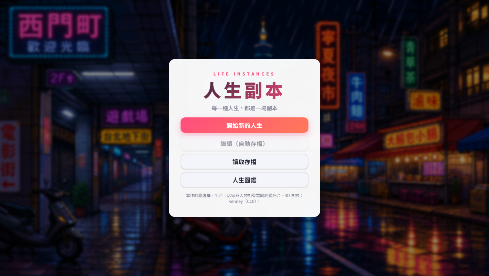
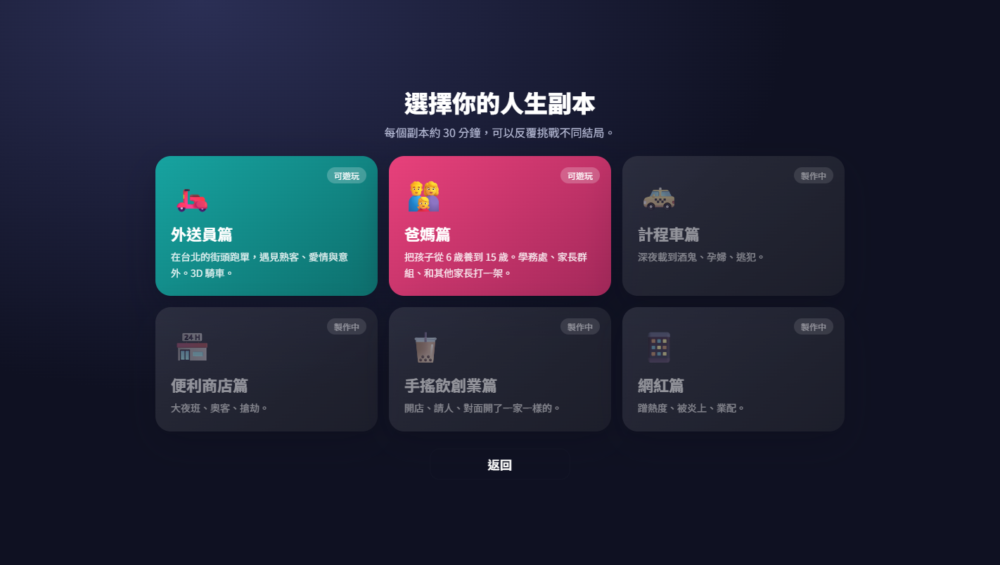
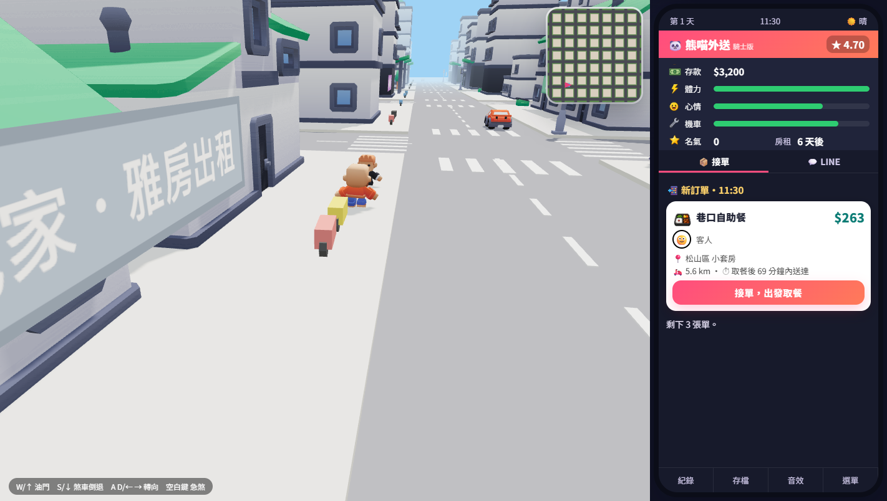
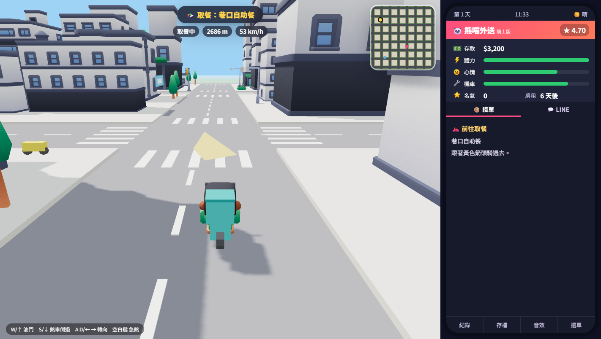
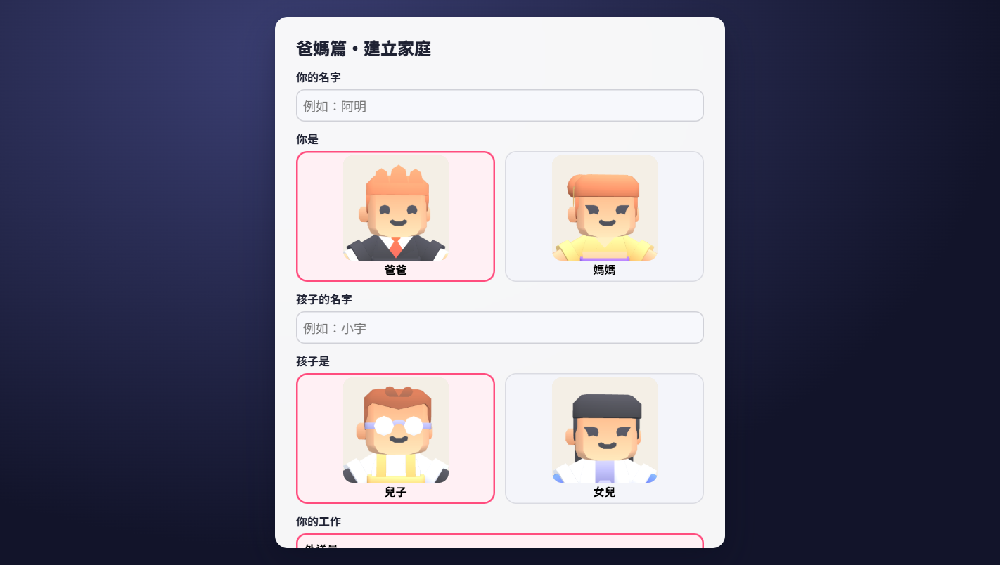
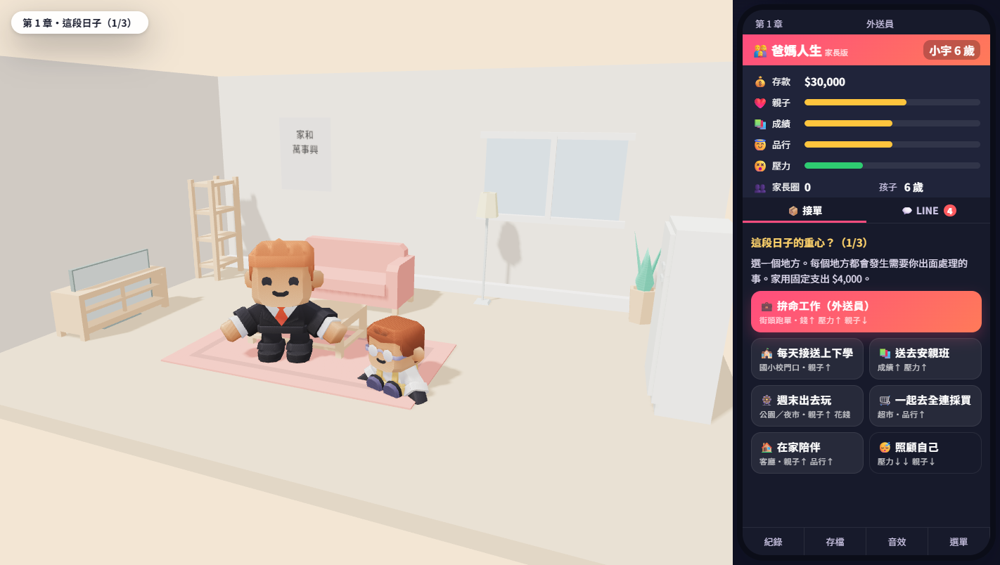
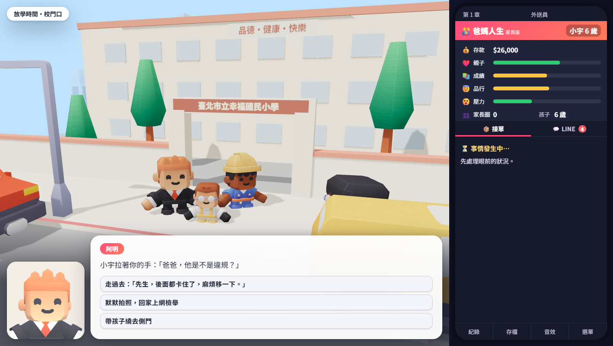
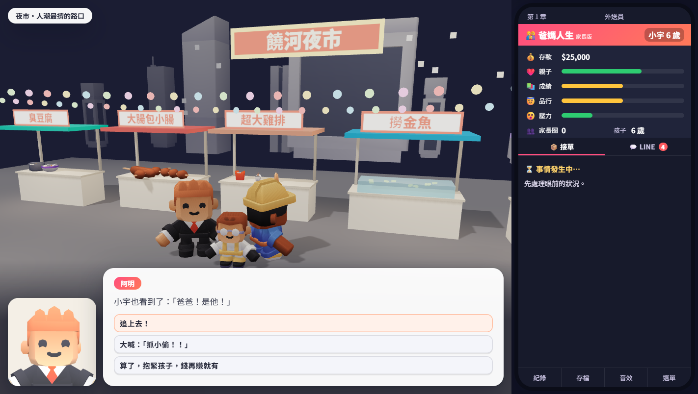
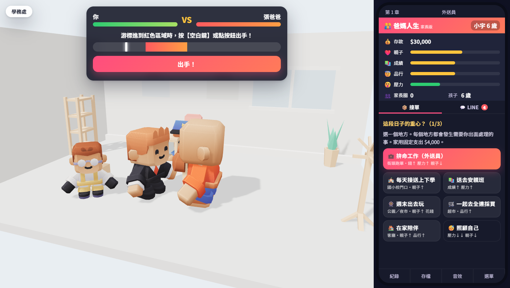

# 人生副本

台灣味、黑色幽默的單機網頁小遊戲。每個「副本」是一段大約 30 分鐘的人生。

**▶ 線上試玩：https://cz481511-cloud.github.io/life-instance/**（免安裝，建議用桌機的 Chrome 或 Edge）

🎬 [宣傳片（47 秒，MP4）](docs/trailer.mp4)



- **外送員篇**：在 3D 台北騎車跑單，每一單都有故事：奧客、暴雨、車禍、隱藏的英雄事件，還有兩條愛情線。
- **爸媽篇**：把孩子從 6 歲養到 15 歲。去校門口、公園、夜市、全連、補習班處理各種狀況，必要時在學務處跟家長打一架。
- 計程車篇、便利商店篇、手搖飲創業篇、網紅篇：製作中。

## 遊戲畫面

### 選擇副本



### 外送員篇

| 接單 | 在 3D 台北騎車 |
|---|---|
|  |  |

### 爸媽篇

| 建立家庭 | 每一輪選擇生活重心 |
|---|---|
|  |  |

| 校門口的突發狀況 | 夜市抓扒手 |
|---|---|
|  |  |

### 學務處打架小遊戲

游標進到紅色區域時按空白鍵出手。



## 怎麼玩

- 騎車：`W/↑` 油門、`S/↓` 煞車、`A/D` 轉向、`空白鍵` 急煞
- 小遊戲：看到提示時按 `空白鍵`
- 存檔只存在你自己的瀏覽器（localStorage），不會上傳到任何地方

## 本機執行

純靜態網頁，沒有建置步驟。因為要載入 3D 模型，請用任何靜態伺服器開啟，不要直接雙擊 `index.html`：

```bash
python -m http.server 8080
```

Windows 沒有 Python 的話，可以用 `tools/serve.ps1`。

開發工具：

- `trailer.html`：宣傳片播放與算圖頁
- `tools/screenshots.ps1`：用無頭 Chrome 自動截取上面的遊戲畫面（需先啟動 `tools/serve.ps1`）

## 專案結構

```
index.html          入口
css/style.css       介面樣式
js/                 遊戲程式（engine, world3d, stage3d, parent, parent_scenes ...）
js/vendor/          three.js r147（已內附，不依賴 CDN）
assets/3d/          Kenney 3D 模型（CC0）
assets/art/         像素風插圖與圖示
docs/               截圖與宣傳片
tools/              本機伺服器、截圖與測試腳本
```

## 授權與素材來源

- 3D 模型：[Kenney](https://kenney.nl)：City Kit (Commercial / Roads / Suburban)、Car Kit、Mini Characters、Furniture Kit、Food Kit，授權為 **CC0**（各資料夾附 `License.txt`）
- 3D 引擎：[three.js](https://threejs.org) r147，MIT License（`js/vendor/three.LICENSE.txt`）
- 像素插圖（`assets/art/`）：以 Higgsfield（gpt_image_2）生成
- 字型：Noto Sans TC（Google Fonts，SIL Open Font License）

遊戲中的品牌與地點都是虛構或諧音改名，與真實店家、機構無關。
